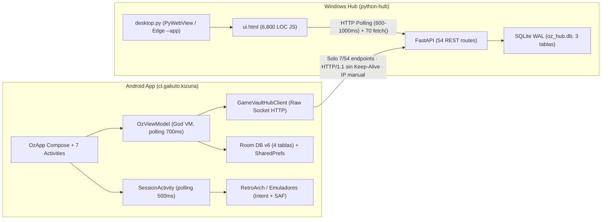

# OzretroRom — Fase 1: Auditoría Técnica Integral y Estado Actual

**Fecha de auditoría:** 2026-11-24  
**Repositorio auditado:** `C:\OzretroRom` (`HEAD = b0d4b4a`, rama `main`)  
**Alcance:** `/android`, `/python-hub` (working tree actual + commit huérfano recuperable `f50a43e`), capa de sincronización/IPC y arquitectura UI/UX.  
**Propósito:** Establecer una línea base empírica, verificable y comparable para ejecutar la **Fase 2 (Arquitectura y Sincronización)** y la **Fase 3 (Rediseño UI/UX Disruptivo)**.

---

## 1. Resumen Ejecutivo y Hallazgo Crítico (P0)

> [!CAUTION]
> **HALLAZGO BLOQUEANTE P0 — Pérdida del código fuente de `/python-hub` en `HEAD` (`b0d4b4a`)**  
> Al auditar el directorio `C:\OzretroRom\python-hub` en disco y compararlo con la historia de Git, se comprobó que **todos los archivos fuente de `/python-hub` (`app/*.py`, `app/engines/*.py`, `app/static/ui.html`, `tests/test_hub.py`, `requirements.txt`, scripts de arranque y compilación) están ausentes en `HEAD` (`b0d4b4a`) y en el directorio de trabajo actual**.  
>
> **Causa raíz verificada en `git reflog`:**
> - `f50a43e` (`2026-11-24 10:50:30 -0300` — *Initial commit*): contenía el código fuente completo de `python-hub/` (28 archivos fuente, 16,829 LOC, incluyendo `brand-console-icon`, `/api/v1/sagas/{saga_id}/ai-audit` y `_ia_advanced_search`), `.gitignore`, `bin/`, `web/` y `LICENSE`.
> - `a9c833c` (`2026-11-24 11:03:22 -0300` — *commit (initial): Agregar carpetas a RetroRom*): commit huérfano que reemplazó la raíz de `main`, dejando vacías las carpetas `python-hub/app/` y versionando por error artefactos pesados (`python-hub/dist/OzRetroRom-Portable-Win64/` con 281 archivos y `ui-audit/node_modules/` con 86 archivos).
> - `b0d4b4a` (`2026-11-24 11:45:13 -0300` — *Adicion APK (Version Android)*): incorporó correctamente los 650 archivos de `android/` sobre `a9c833c`.
>
> **Estado de recuperación:** **100% recuperable localmente.** El commit `f50a43e` sigue intacto en `.git` (object database local) y existe además una copia compilada de `ui.html` en `python-hub/dist/OzRetroRom/_internal/app/static/ui.html`. **No se debe ejecutar `git gc` ni clonar de cero antes de restaurar el árbol de `python-hub/` desde `f50a43e`.**

---

## 2. Inventario Cuantitativo y Línea Base (Métricas Comparables)

Esta tabla sirve como **línea base objetiva** para auditar la reducción de complejidad, deuda técnica y latencia al finalizar las Fases 2 y 3.

| Dimensión | `/python-hub` (Working Tree `HEAD`) | `/python-hub` (Código en `f50a43e`) | `/android` (`HEAD = b0d4b4a`) |
| :--- | :---: | :---: | :---: |
| **Estado en disco (`HEAD`)** | Solo `ozretrorom.spec` + `dist/` + `.venv/` | 28 archivos fuente recuperables | Completo, compilable y versionado (650 archivos) |
| **Archivos fuente medidos** | 1 (`.spec`, 68 LOC) | 28 (`.py/.html/.ps1/.bat/.spec`) | 189 en `app/src/main` (`.kt/.xml`) |
| **Total líneas de código (LOC)** | 68 LOC | **16,829 LOC** | **38,917 LOC** (`main`) + **5,110 LOC** (`test`) |
| **Archivo más grande (Monolito)** | — | `app/static/ui.html` (**6,800 LOC**) | `SessionActivity.kt` (**2,248 LOC**) |
| **Endpoints REST / Rutas** | 0 en fuente | **54 endpoints FastAPI** | 4 rutas detalle + 5 destinos top Compose |
| **Canales Push (WS / SSE)** | 0 | **0 WebSockets / 0 SSE** | **0 WS / 0 SSE** (polling manual) |
| **Loops de Polling activos** | — | 3 pollers JS (`600ms / 900ms / 1000ms`) | 4 archivos con `while + delay(180..700ms)` |
| **Almacenamiento local** | SQLite en `data/` | SQLite WAL (`rom_meta`, `rom_patches`, `settings`) | Room v6 (4 entidades) + `SharedPreferences` (703 LOC) |
| **Pruebas unitarias verificadas** | Ausentes en disco | `tests/test_hub.py` (1,094 LOC; 20 tests) | 56 archivos (5,110 LOC; 270/270 tests) |
| **Contaminación Git (`HEAD`)** | 281 archivos de `dist/` + 86 `node_modules` | — | Limpio (`.gitignore` filtra `build/`, `.gradle/`, `.apk`) |

---

## 3. Auditoría Detallada por Subsistema

### 3.1. Directorio `/python-hub` (Backend + Web UI + Desktop Wrapper)

> Nota: El análisis arquitectónico refleja el código fuente verificado en `f50a43e` (última versión funcional construida y validada antes del commit huérfano `a9c833c`).

#### Stack y Empaquetado
- **Runtime:** Python 3.13, FastAPI (`>=0.115.0`), Uvicorn (`>=0.32.0`), `httpx` (`>=0.28.0`), Pillow (`>=11.0.0`), `pytest` (`>=8.3.0`).
- **Desktop / Portable:** `app/desktop.py` (173 LOC) levanta `uvicorn` en un hilo daemon sobre `0.0.0.0:17894` (o puerto efímero) y abre una ventana mediante `pywebview` con fallback a `msedge.exe`/`chrome.exe --app=http://127.0.0.1:<port>/`. Empaquetado con PyInstaller (`packaging/ozretrorom.spec`).

#### Concentración de Complejidad (Top Monolitos en `f50a43e`)
| Archivo | LOC | Diagnóstico Técnico |
| :--- | :---: | :--- |
| `app/static/ui.html` | **6,800** | Monolito SPA completo (CSS + HTML + JS vanilla + 70 llamadas `api()`). Sin tipado, sin módulos ES, sin gestor de estado reactivo; solo 2 usos de `localStorage`. |
| `app/sagas.py` | **2,166** | Catálogo curado de sagas y reglas de emparejamiento hardcodeadas en Python; duplicado conceptualmente respecto a `SagasRepository.kt` (1,472 LOC) en Android. |
| `app/main.py` | **1,078** | 54 rutas FastAPI concentradas en un solo `create_app()` sin `APIRouter` modulares ni esquemas Pydantic unificados de respuesta. |
| `app/recommendations.py` | **1,046** | Motor de afinidad local, `CURATED_CLASSICS`, mood picker e integración LLM en un único módulo. |
| `app/covers.py` | **570** | Descarga y caché WebP multi-proveedor; reporta progreso solo mediante estado en memoria consultado por polling. |
| `app/db.py` | **469** | SQLite en modo `WAL`, con solo 3 tablas (`rom_meta`, `rom_patches`, `settings`); no persiste historial de cola de descargas/FTP ni registro de revisiones delta para clientes LAN. |

#### Deuda Técnica Principal en `/python-hub`
1. **Sin separación Frontend/Backend ni build pipeline:** cualquier cambio visual exige editar un HTML de 6,800 líneas sin hot-reload ni verificación estática.
2. **Duplicación de lógica de dominio PC ↔ Android:** tanto `sagas.py` como `SagasRepository.kt`, y tanto `ia_client.py` como `VaultCatalogSearchEngine.kt`, duplican listas curadas, regexes y filtros de Archive.org/MiNERVA con riesgo constante de divergencia.
3. **Ausencia de `.gitignore` en la raíz `C:\OzretroRom`:** provocó el versionado de `python-hub/dist/OzRetroRom-Portable-Win64/` (DLLs, `.pyd`, ejecutables) y `ui-audit/node_modules/`.

---

### 3.2. Directorio `/android` (App Nativa Android)

#### Stack y Configuración (`android/app/build.gradle.kts`)
- **Identidad:** `cl.gakuto.kizuna`, `versionName = "0.6.0-beta.4"`, `versionCode = 60018`, `minSdk = 26`, `compileSdk = targetSdk = 36`, `jvmTarget = 17`, ABI restringida a `arm64-v8a` (por `libtorrent4j-android-arm64:2.1.0-32`).
- **UI y Arquitectura:** Jetpack Compose BOM `2026.06.00`, Navigation Compose `2.9.8`, Paging 3 (`3.5.0`), Coil 3 (`3.2.0`), Media3 ExoPlayer (`1.10.1`), Room `2.8.4` (`version = 6`, 4 tablas: `GameEntity`, `CollectionEntity`, `CollectionMembershipEntity`, `CatalogSystemStateEntity`), WorkManager `2.10.1`.
- **Seguridad de Red (`AndroidManifest.xml`):** `usesCleartextTraffic="false"` con `network_security_config`, permisos `FOREGROUND_SERVICE_DATA_SYNC`, `RUN_USER_INITIATED_JOBS`, `POST_NOTIFICATIONS` y visibilidad explícita de paquetes (`RetroArch`, `iiSU`, `PPSSPP`, `melonDS`, `DuckStation`, `Dolphin`, `Azahar`, `Flycast`, `Yaba Sanshiro`, `Play!`).

#### Distribución de Código y Monolitos (`app/src/main` — 38,917 LOC)
| Paquete / Archivo | Archivos / LOC | Diagnóstico Técnico |
| :--- | :---: | :--- |
| `launch/` (`SessionActivity.kt`) | 45 / 9,893 (2,248) | `SessionActivity.kt` concentra ciclo de vida de descarga, recuperación HTTP/Torrent, extracción de discos PS1, validación BIOS, lanzamiento RetroArch y bindings XML (`activity_session.xml` + `layout-land`). |
| `ui/compose/` (`OzApp.kt`, `OzViewModel.kt`) | 4 / 3,577 (1,924 + 1,218) | `OzViewModel` actúa como *God ViewModel* mezclando catálogo, colecciones, sagas, auditoría IA, parches IPS/BPS, FTP, PC Hub, autenticación IA y preferencias de tema. |
| `ui/compose/screens/` (`SagasScreens.kt`, `CatalogHubScreen.kt`, `GameDetailScreen.kt`) | 5 / 3,563 | Pantallas Compose modernas, pero desconectadas de las 6 Activities heredadas en `ui/`. |
| `ui/` (Activities heredadas) | 15 / 3,826 | **11 layouts XML** y **7 Activities independientes** (`SettingsActivity`, `LibrarySettingsActivity`, `CatalogDownloadSettingsActivity`, `EmulationIntegrationSettingsActivity`, `EmulatorSettingsActivity`, `InternetArchiveLoginActivity`, `SessionActivity`). |
| `catalog/` (`RomgiCatalog.kt`, `VaultCatalogSearchEngine.kt`) | 21 / 3,583 | Mezcla motor heredado ROMgi con el nuevo motor unificado MiNERVA + Internet Archive + PC Hub. |
| `data/` (`AppPreferences.kt`, `OzDatabase.kt`) | 12 / 1,993 | `AppPreferences.kt` (703 LOC) almacena estado crítico (rutas SAF, artwork sincronizado, parches, claves API, configuración de motor) en `SharedPreferences` síncrono sin reactividad transaccional. |

---

## 4. Auditoría de Comunicación Interprocesos (IPC), Sincronización y Persistencia

### Cuellos de Botella Identificados (Insumos Directos para Fase 2)

1. **Polling en lugar de Push (Latencia y Desperdicio de CPU/Batería):**
   - **Web/Desktop:** `pollCoverSync` (600ms), `pollDownloads` (900ms), `pollTransfers` (1000ms). No existe ningún canal `SSE` ni `WebSocket`.
   - **Android interno:** `OzViewModel.kt` sondea `CatalogPreparationTaskStore` y `CollectionBatchTaskStore` cada `700ms`; `SessionActivity.kt` sondea descargas cada `500ms`; `AuthorizedSourceDownloader.kt` usa `delay(650)`.
2. **Puente Android ↔ PC Hub subutilizado y frágil (`GameVaultHubClient.kt`):**
   - De los **54 endpoints** de FastAPI, Android solo consume **7 rutas** (`/health`, `/api/v1/library`, `/api/v1/catalog/search`, `/api/v1/library/{id}/download`, `/api/v1/transfers`, `/api/v1/covers/sync`, `/api/v1/sagas/{id}/ai-audit`).
   - Implementa un cliente HTTP/1.1 manual sobre `java.net.Socket` crudo (sin connection pooling, sin HTTP/2, sin compresión gzip automática y sin cancelación cooperativa avanzada) para sortear `usesCleartextTraffic="false"` en IPs RFC-1918.
   - Sin descubrimiento automático en red local (**mDNS / NSD**): exige ingreso manual de IP y puerto.
   - `fetchLibrary()` descarga el JSON completo (truncado arbitrariamente a `limit = 250`) en lugar de paginación o **delta-sync** basado en `revision`/`updatedAt`.
3. **Persistencia fragmentada y cero sincronización de estado de usuario:**
   - PC y Android mantienen bibliotecas, favoritos, conteo de partidas, carátulas personalizadas y API keys completamente desconectados.
   - En PC, las colas activas de descargas IA y transferencias FTP viven en diccionarios en memoria (se pierden al reiniciar el proceso).
   - En Android, `AppPreferences.kt` (703 LOC en `SharedPreferences`) almacena metadatos por juego (`syncedArtworkLocalUri`, `patchedRom`, `customArtworkUrl`) en claves planas difíciles de respaldar o sincronizar, cuando pertenecen a Room o DataStore.

---

## 5. Auditoría UI/UX Actual (Insumos Directos para Fase 3)

### Problemas Estructurales del Dashboard Actual
1. **Sobrecarga de pantallas de inicio (Fatiga de decisión):**
   - **Windows Hub (`view-home`):** apila Hero + barra de 5 KPIs numéricos + 13+ tarjetas de consolas + Recomendaciones + 8 píldoras MiNERVA + 12 Destacados + Recientes + barra lateral de 7 secciones + 13 filtros de consola. Un usuario que solo quiere lanzar su juego o buscar una ROM recorre demasiados bloques antes de actuar.
   - **Android (`HomeScreen` en `OzApp.kt`):** replica la lógica de dashboard pesado (Hero + Strip de consolas + matriz de 6 píldoras de herramientas rápidas + Mosaico/Destacados + Rail de Sagas + Favoritos + Recientes), desperdiciando espacio vertical crítico en pantallas móviles de 6"–6.7".
2. **Ruptura de continuidad entre Compose y Activities XML (Android):**
   - Navegar a *Ajustes avanzados* o *Descarga/Lanzamiento* cambia de paradigma visual y de pila de navegación (Compose → Activity XML/Compose separada), impidiendo que el usuario siga explorando la app mientras descarga una ROM en una hoja deslizable persistente (*Mini-player / Bottom Sheet de descargas*).
3. **Inconsistencia entre Desktop y Mobile:**
   - La app web en PC fue diseñada como panel de administración desktop-first con sidebar fija, mientras que Android usa navegación inferior de 5 pestañas (`Catálogo`, `Sagas`, `Inicio`, `Biblioteca`, `Ajustes`). No comparten un patrón de flujo minimalista centrado en **acción inmediata**.

---

## 6. Declaración Explícita de Limitaciones Técnicas como IA en Esta Auditoría

Para garantizar transparencia y rigor de ingeniería, declaro explícitamente las limitaciones de este análisis automatizado:

1. **Sin ejecución ni perfilado en hardware físico Android:** No puedo ejecutar la app en un dispositivo real (ni medir *frame drops*, consumo de RAM, tiempos de arranque en frío TTID/TTFD, rendimiento real de `libtorrent4j` ni latencia de SAF/`DocumentFile` en capas OEM como MIUI, HyperOS o OneUI).
2. **Sin medición empírica de red LAN real:** Los cuellos de botella de `GameVaultHubClient` y el polling HTTP se infieren del diseño del código y arquitectura de transporte, no de capturas de paquetes ni benchmarks reales bajo Wi-Fi doméstico o transferencia FTP hacia PS4/PS3/Switch.
3. **Ausencia de pruebas con usuarios humanos reales:** El diagnóstico UX y la propuesta disruptiva de Fase 3 se basan en heurísticas de diseño móvil (ley de Fitts, ergonomía de pulgar, reducción de carga cognitiva y arquitectura de información), pero requieren validación interactiva tuya en dispositivo real.
4. **Cobertura sobre monolitos de gran tamaño:** Dado el tamaño de archivos como `ui.html` (6,800 LOC) y `SessionActivity.kt` (2,248 LOC), el análisis combina inspección estructural automatizada (AST/regex/rutas) con lecturas focalizadas; pueden existir casos borde internos en funciones auxiliares no inspeccionadas línea por línea.
5. **Estado del repositorio condicionado al entorno local:** La auditoría refleja únicamente los archivos presentes en `C:\OzretroRom` y sus objetos Git locales al momento del análisis; no tiene visibilidad sobre estados remotos en GitHub no sincronizados ni ventanas abiertas en GitHub Desktop o Android Studio.

---

## 7. Estrategia Más Eficiente para Proceder

Para maximizar impacto y minimizar retrabajo, la secuencia óptima de ejecución es:

### Paso 0 — Remediación Obligatoria de Repositorio (Prerrequisito P0)
1. **Restaurar el código fuente de `python-hub/` desde `f50a43e`** (`git checkout f50a43e -- python-hub/app python-hub/tests python-hub/scripts python-hub/packaging python-hub/requirements.txt python-hub/start-python-hub.ps1 python-hub/start-python-hub.bat python-hub/OzRetroRom-Desktop.bat python-hub/Dockerfile ui-audit/audit-ui.mjs`).
2. **Crear `.gitignore` raíz en `C:\OzretroRom\.gitignore`** para excluir `python-hub/dist/`, `python-hub/build/`, `python-hub/.venv/`, `python-hub/data/`, `ui-audit/node_modules/` y `ui-audit/reports/`, y purgar esos binarios del índice Git (`git rm -r --cached`) sin borrar los ejecutables locales del disco.
3. Confirmar `pytest` (20/20) y `gradlew testDebugUnitTest` (270/270) en verde antes de iniciar Fase 2.

### Fase 2 — Arquitectura, IPC de Latencia Cero y Persistencia Unificada
1. **Canal Push en Tiempo Real (Adiós Polling):**
   - Implementar un bus de eventos en memoria en FastAPI expuesto vía **SSE (`GET /api/v1/events`)** (y/o WebSocket `/ws/events`) que emita cambios instantáneos de progreso de descargas, carátulas, transferencias FTP y biblioteca.
   - En Android, migrar `CatalogPreparationTaskStore`, `CollectionBatchTaskStore` y `RomDownloadTaskStore` a **`StateFlow` / Room observables** eliminando los loops `while + delay(500..700ms)`.
2. **Puente LAN Moderno y Persistencia Sincronizada:**
   - Anunciar el Windows Hub por **mDNS (`_ozvault._tcp.local.`)** con descubrimiento automático vía Android `NsdManager` (conexión en 1 toque sin escribir IP).
   - Reemplazar el cliente `Socket` crudo de `GameVaultHubClient` por **OkHttp** (ya presente en el classpath vía `coil-network-okhttp:3.2.0`) con `network_security_config` restringido a subredes privadas o TLS autofirmado con *pinning* por QR, habilitando HTTP Keep-Alive, compresión gzip y streaming eficiente.
   - Añadir **Delta Sync (`GET /api/v1/sync?since=<rev>`)** respaldado por tabla `sync_log` y persistencia de colas (`download_jobs`, `transfer_jobs`) en SQLite (PC) y Room v7 (Android), unificando favoritos, historial de juego y metadatos en ambos sentidos.
   - Extraer `sagas_catalog.json` como **fuente única de verdad compartida** entre `/python-hub` y `/android` para eliminar la duplicación `sagas.py` vs `SagasRepository.kt`.
3. **Descomposición Modular Progresiva:**
   - Dividir `OzViewModel.kt` (1,218 LOC) en ViewModels por dominio (`HomeViewModel`, `CatalogViewModel`, `SagasViewModel`, `SyncViewModel`, `SettingsViewModel`) y migrar `AppPreferences.kt` a DataStore + columnas Room.
   - Extraer CSS/JS de `ui.html` (6,800 LOC) a una arquitectura frontend modular liviana (ES Modules + Vite o Preact) compartiendo tokens de diseño con `OzTheme.kt`.

### Fase 3 — Rediseño UI/UX Disruptivo (Minimalismo Mobile-First, Sin Dashboard)
Eliminar el paradigma de *dashboard administrativo* tanto en Android como en el cliente responsive del Hub y sustituirlo por un **flujo móvil de acceso directo en 3 destinos + 1 hoja flotante**:

| Destino | Propósito | Acceso Directo (<= 1 toque) |
| :--- | :--- | :--- |
| **1. Jugar** *(Reemplaza al Dashboard)* | Portada minimalista sin KPIs ni 6 estanterías. | Card principal **"Continuar ahora"** + barra **Omnibox** (busca local, PC Hub y MiNERVA a la vez) + tira horizontal compacta de últimos juegos / favoritos. |
| **2. Explorar** *(Catálogo + Sagas)* | Descubrimiento visual sin ruido. | Alternador segmentado **Consolas / Sagas** con retícula uniforme proporción NDS (3 columnas), sin números ni etiquetas redundantes. |
| **3. Ajustes** *(Unificado en Compose)* | Configuración consolidada sin saltar entre 7 Activities. | Secciones limpias: Emparejamiento PC Hub (mDNS/QR), RetroArch/Emuladores, Almacenamiento y IA/Carátulas. |
| **+ Hoja Flotante de Actividad** *(Reemplaza `SessionActivity` XML)* | Telemetría en tiempo real sin bloquear la navegación. | *Bottom Sheet* colapsable (estilo reproductor) impulsado por SSE/`StateFlow` para descargas ROM, parches `[ES]`, sync de carátulas y envíos FTP. |

---

## 8. Criterios de Aceptación y Registro de Decisiones Autorizadas

- [x] Aprobación del usuario para ejecutar el **Paso 0** (restauración de `python-hub/` desde `f50a43e`, `.gitignore` raíz y limpieza del índice Git) — **Autorizado y ejecutado el 2026-11-24**.
- [x] Confirmación de prioridades para **Fase 2** (`lo más seguro`) — **Autorizado el 2026-11-24** bajo ejecución secuencial incremental verificada por hito.

### Registro de Decisiones de Arquitectura (ADR)

| ID | Decisión | Enfoque Autorizado | Estado / Evidencia Verificada |
| :--- | :--- | :--- | :--- |
| **ADR-001** | **Remediación P0 del Repositorio (Paso 0)** | Restaurar el código fuente de `python-hub/` y scripts de `ui-audit/` desde `f50a43e` (sin restaurar credenciales privadas en `data/.oz-ps4/`), añadir `.gitignore` en la raíz `C:\OzretroRom\` y sacar `python-hub/dist/`, `ui-audit/node_modules/` y `__pycache__/` únicamente del índice Git (`git rm --cached`) preservando los ejecutables locales en disco. | **Ejecutado y verificado (2026-11-24).** `pytest -q`: **20 passed, 0 failed** (`39.31s`). `/android` sin modificaciones (`0` cambios en Git). Ejecutable portable intacto en disco (`dist/OzRetroRom-Portable-Win64/OzRetroRom/OzRetroRom.exe`). Pendiente solo tu *commit & push* en GitHub Desktop. |
| **ADR-002** | **Estrategia de Ejecución de Fase 2 (`Lo más seguro`)** | En lugar de refactorizar ambos frentes en paralelo con alto riesgo de regresión, ejecutar la **Fase 2 de forma secuencial e incremental**, validando pruebas automáticas entre hitos: 1. **Hito 2A — Puente IPC y Persistencia Primero:** implementar bus SSE (`GET /api/v1/events`) en FastAPI, descubrimiento LAN vía mDNS (`_ozvault._tcp.local.` + `NsdManager`), migración de `GameVaultHubClient` a OkHttp, Delta Sync (`/api/v1/sync?since=<rev>`) y persistencia de colas en SQLite / Room v7. 2. **Hito 2B — Desacoplamiento Modular Después (sobre IPC estable):** unificar `sagas_catalog.json`, dividir `OzViewModel.kt` por dominio + migrar `AppPreferences` a DataStore/Room y modularizar `ui.html` progresivamente antes de la Fase 3. | **Aprobado para ejecución.** Punto de entrada inmediato: **Fase 2 — Hito 2A**. |

