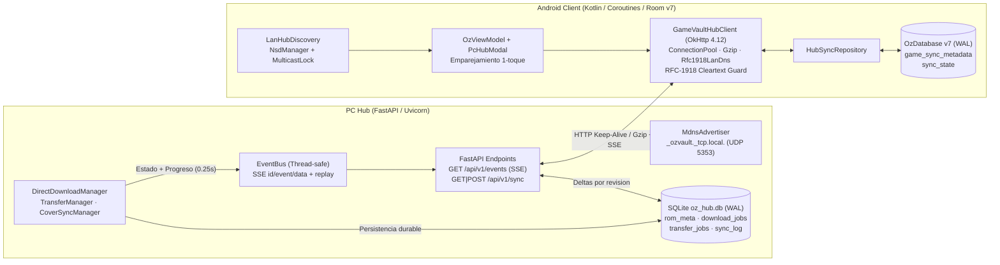

# OzretroRom — Reporte Técnico de Fase 2, Hito 2A (`ADR-002`)

**Fecha:** 2026-11-24  
**Estrategia aplicada:** `ADR-002` — Modernización incremental (Hito 2A: IPC en tiempo real SSE, descubrimiento mDNS en LAN, cliente OkHttp RFC-1918, persistencia de colas en SQLite, sincronización incremental `/api/v1/sync` y migración Room `v6 → v7`).  
**Regla de alcance:** Sin alteración de vistas principales (`HomeScreen`, `SagasScreens`, `CatalogHubScreen`, `LibraryScreen`, `ui.html`) ni ruptura de compatibilidad REST.

---

## 1. Arquitectura IPC y Sincronización Implementada

---

## 2. Resumen de Cambios por Subsistema

### 2.1 Backend `/python-hub`

1. **Event Bus SSE Thread-Safe (`python-hub/app/events.py`, 115 líneas):**
   - Implementa `EventBus` y `BusEvent` con historial acotado (`maxlen=128`) para rehidratación por `Last-Event-ID` o `since_id`, backpressure no bloqueante en colas de suscriptores y despacho seguro desde hilos de trabajo síncronos mediante `loop.call_soon_threadsafe`.
   - Expuesto en `GET /api/v1/events` (`text/event-stream`, keepalive cada `15s`, soporte `?once=1` para verificación determinista).

2. **Anuncio Automático mDNS / DNS-SD (`python-hub/app/mdns.py`, 296 líneas):**
   - Implementa `MdnsAdvertiser` en biblioteca estándar RFC-6762 (`224.0.0.251:5353`, servicio `_ozvault._tcp.local.` con registros `PTR`, `SRV`, `TXT` y `A`, más paquete goodbye `TTL=0` al apagar), sin dependencias nativas externas para mantener compatibilidad con empaquetado PyInstaller portable.
   - Integrado en el `lifespan` de `main.py` y configurado desde `desktop.py` mediante `OZ_ADVERTISED_PORT` / `OZ_BIND_HOST` / `OZ_DISABLE_MDNS`.

3. **Persistencia de Colas y Registro Incremental en SQLite (`python-hub/app/db.py`, 954 líneas):**
   - Nuevas columnas retrocompatibles en `rom_meta`: `quick_resume_json`, `custom_metadata_json`, `updated_at`.
   - Nuevas tablas:
     - `download_jobs` y `transfer_jobs`: `DirectDownloadManager` (`ia_client.py`) y `TransferManager` (`transfers.py`) persisten transiciones de estado y marcan trabajos inconclusos tras un reinicio como `interrupted` sin perder el historial.
     - `sync_log` (+ índice `idx_sync_log_entity`): bitácora incremental por `revision` autoincremental alimentada por `toggle_favorite`, `mark_played` y `POST /api/v1/sync`.
   - Merge determinista en `apply_sync_changes`: `max(playCount)`, timestamp más reciente en `lastPlayedAt` / `favorite` y fusión de JSON en `quickResume` y `customMetadata`.

4. **Integración en Gestores y Rutas (`covers.py`, `transfers.py`, `ia_client.py`, `main.py`, `desktop.py`):**
   - Emisión de eventos SSE: `covers.progress`, `covers.complete`, `download.state`, `download.progress` (throttled `0.25s`), `transfer.state`, `transfer.progress` (throttled `0.25s`), `library.updated` y `sync.updated`.
   - Nuevas rutas en `main.py`: `GET /api/v1/events`, `GET /api/v1/sync`, `POST /api/v1/sync`, manteniendo intactos todos los endpoints previos consumidos por `ui.html`.

### 2.2 Cliente `/android`

1. **Cliente OkHttp + Seguridad RFC-1918 (`GameVaultHubClient.kt`, 539 líneas; `build.gradle.kts`; `network_security_config.xml`):**
   - Se sustituyeron los sockets crudos HTTP (`java.net.Socket` y `HttpURLConnection`) por un cliente compartido **OkHttp `4.12.0`** con `ConnectionPool(5, 5m)`, compresión gzip transparente, lector SSE (`streamEvents` sobre `sseClient`) y métodos de sincronización (`fetchSyncDelta`, `pushSyncDelta`).
   - `network_security_config.xml` mantiene `<base-config cleartextTrafficPermitted="false">` para Internet público y habilita cleartext exclusivamente para `localhost`, `127.0.0.1`, `*.local` y `*.lan.ozvault.local`.
   - Para IPs privadas literales RFC-1918 (`10.x`, `172.16-31.x`, `192.168.x`), `GameVaultHubClient` reescribe la URL interna a `<a-b-c-d>.lan.ozvault.local` con header `Host` original, resolviendo offline vía `Rfc1918LanDns` y validando cada petición en `lanGuardInterceptor`.

2. **Descubrimiento LAN mDNS (`LanHubDiscovery.kt`, 192 líneas; `AndroidManifest.xml`):**
   - Usa `NsdManager` + `WifiManager.MulticastLock` para descubrir `_ozvault._tcp.` en Wi-Fi local y resolver servicios secuencialmente en `StateFlow<List<DiscoveredLanHub>>`.
   - Conectado en `OzViewModel.kt` y mostrado exclusivamente dentro del modal de conexión `PcHubModal` (`FtpAndHubModals.kt`) para emparejar en un toque y observar estado SSE en vivo.

3. **Migración Room `v6 → v7` y Repositorio de Sync (`Entities.kt`, `Daos.kt`, `OzDatabase.kt`, `HubSyncRepository.kt`):**
   - Nuevas entidades: `GameSyncMetadataEntity` (`game_sync_metadata` con 3 índices) y `SyncStateEntity` (`sync_state`), además de `SyncMetadataDao` y `MIGRATION_6_7`.
   - Generado esquema exportado `android/app/schemas/cl.gakuto.kizuna.data.OzDatabase/7.json`.
   - `HubSyncRepository` migra de forma no destructiva metadatos por juego desde `AppPreferences` y sincroniza cambios bidireccionales con `/api/v1/sync`.

---

## 3. Comparativa vs Línea Base de Fase 1

| Métrica / Capacidad | Línea Base (Fase 1) | Estado Post Hito 2A (Medido) |
| :--- | :---: | :---: |
| Tests `/python-hub` (`pytest`) | `20 passed, 0 failed` | **`22 passed, 0 failed`** (`54.35s`) |
| Tests `/android` (`testDebugUnitTest`) | `270 passed, 0 failed` | **`274 passed, 0 failed, 0 skipped`** (`58` suites) |
| Transporte LAN Android → PC Hub | `java.net.Socket` manual + HTTP `Connection: close` | **OkHttp `4.12.0`** con pool persistente + Gzip + guarda RFC-1918 |
| Actualizaciones PC Hub → Android | Polling manual / HTTP puntual | **SSE en tiempo real** (`GET /api/v1/events`) |
| Descubrimiento PC Hub en LAN | IP manual | **mDNS automático** (`_ozvault._tcp.local.` + `NsdManager`) |
| Persistencia colas IA / FTP en PC | Solo diccionario en memoria | **SQLite (`download_jobs`, `transfer_jobs`)** con recuperación |
| Versión esquema Room Android | `v6` (metadatos solo en `SharedPreferences`) | **`v7` (`7.json` + `MIGRATION_6_7`)** con `game_sync_metadata` y `sync_state` |
| Sincronización de estado de juego | Inexistente entre dispositivos | **Bidireccional por deltas** (`GET/POST /api/v1/sync`) |
| `ui.html` y vistas principales Compose | Intactas para Fase 3 | **Sin modificaciones** |

---

## 4. Verificación Ejecutada tras la Edición Final

- **Python (`/python-hub`):**
  - Comando: `Set-Location C:\OzretroRom\python-hub; .\.venv\Scripts\python.exe -m pytest -q`
  - Resultado: `22 passed, 1 warning in 54.35s` (`0` fallos). Incluye pruebas de `EventBus` cross-thread, `GET /api/v1/events?once=1`, paquetes mDNS anuncio/goodbye, persistencia de colas tras reinicio de `HubDatabase` y fusión incremental en `GET/POST /api/v1/sync`.
- **Android (`/android`):**
  - Comando: `Set-Location C:\OzretroRom\android; .\gradlew.bat testDebugUnitTest --no-daemon`
  - Resultado: `BUILD SUCCESSFUL in 1m 57s` — `274` tests ejecutados en `58` suites (`0` fallos, `0` errores, `0` omitidos). Incluye `GameVaultHubClientAndSyncTest` (OkHttp + gzip + sync + SSE + política RFC-1918/mDNS) y `OzDatabaseMigration6To7Test` (Robolectric v6 → v7 preservando datos previos).
- **Alcance Git:** Todos los archivos nuevos y modificados residen estrictamente dentro de `C:\OzretroRom`, listos para revisión manual en GitHub Desktop (sin `commit` ni `push` automáticos).
